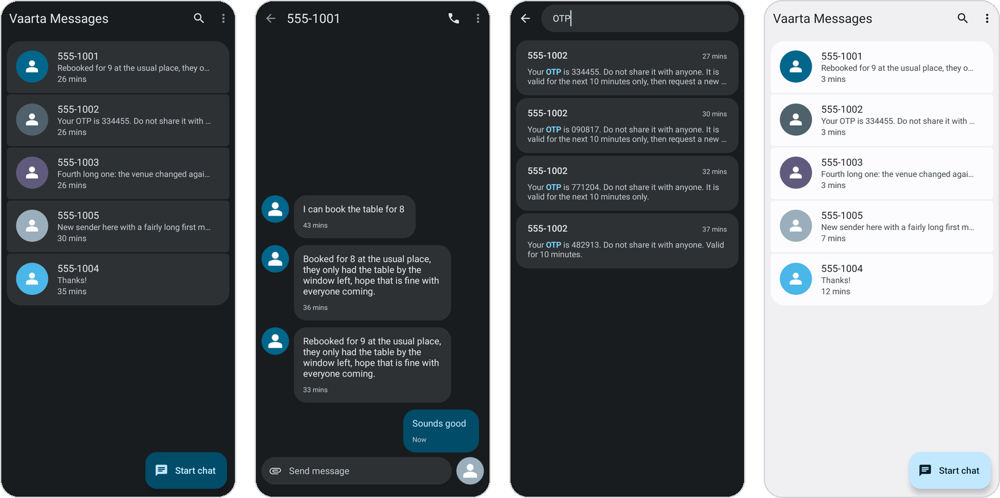

<div align="center">


# Vaarta Messages

A calm, modern SMS app for Android.

*Vaarta* (वार्ता), from Hindi and Sanskrit, means conversation.

<br>



</div>

<br>

## What it is

Plain SMS and MMS, redrawn in Material 3 Expressive. No accounts, no ads, no
tracking, no RCS.

- **Colours from your wallpaper**, in light and dark
- **Conversations as rounded cards**, messages as soft grouped bubbles
- **Search** across every message
- **Mark all as read** in one tap
- **Clear about one-way senders**: no message box where a reply can't be sent
- **Small**: no added libraries beyond what the original app used

## Install

Download `Vaarta-release` from the latest
[Build app](../../actions/workflows/build.yml) run, unzip it and install the
APK. Android 13 or newer.

This is an early build. Try it alongside your current SMS app before relying
on it.

## Build

```
./scripts/fetch-deps.sh
./gradlew assembleDebug
```

Needs JDK 17 and the Android SDK. The APK lands in `build/outputs/apk/debug/`
and installs as `io.github.harryl0l.vaarta`.

<details>
<summary>Signed release builds on GitHub Actions</summary>

<br>

Debug builds from Actions are signed with a throwaway key, so one cannot be
installed over another. For release APKs signed with your own key, add these
repository secrets:

| Secret | Value |
| --- | --- |
| `VAARTA_KEYSTORE_BASE64` | your keystore file, base64-encoded |
| `VAARTA_KEYSTORE_PASSWORD` | keystore password |
| `VAARTA_KEY_ALIAS` | key alias |
| `VAARTA_KEY_PASSWORD` | key password |

</details>

<details>
<summary>Building inside an Android source tree</summary>

<br>

`Android.bp` still builds the app as part of a LineageOS or AOSP tree, where
it keeps the system package name `com.android.messaging`.

</details>

## Credits

Vaarta Messages is not written from scratch. It builds on:

- **[LineageOS Messaging](https://github.com/LineageOS/android_packages_apps_Messaging)**
  by The LineageOS Project, which this repository was forked from
- **[AOSP Messaging](https://android.googlesource.com/platform/packages/apps/Messaging/)**
  by The Android Open Source Project, which LineageOS Messaging is based on

All credit for the underlying app belongs to those projects and their
contributors. Their authorship is preserved in the commit history and in the
copyright headers of the source files.

## Licence

Apache License 2.0. See [LICENSE](LICENSE).

    Copyright (C) 2015 The Android Open Source Project
    Copyright (C) The LineageOS Project

Changed files keep the upstream copyright notices, as the licence requires.
Licences of bundled third-party components are in `assets/licenses.html`.
